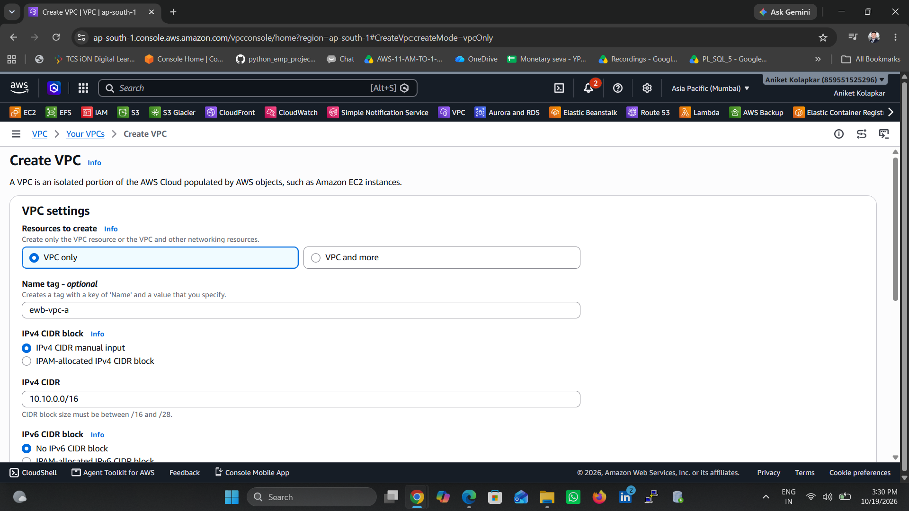
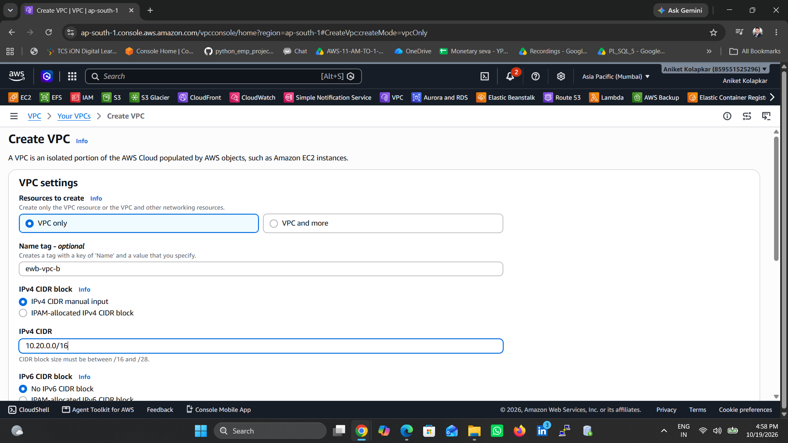
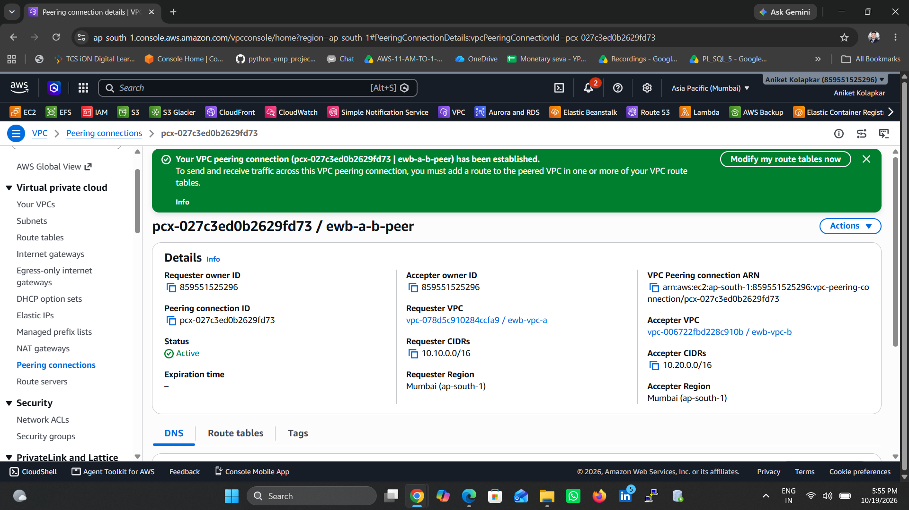
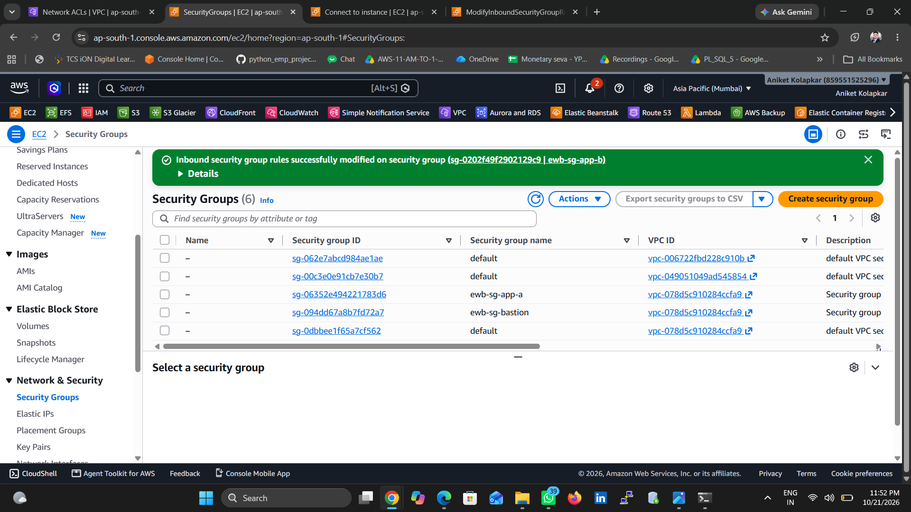
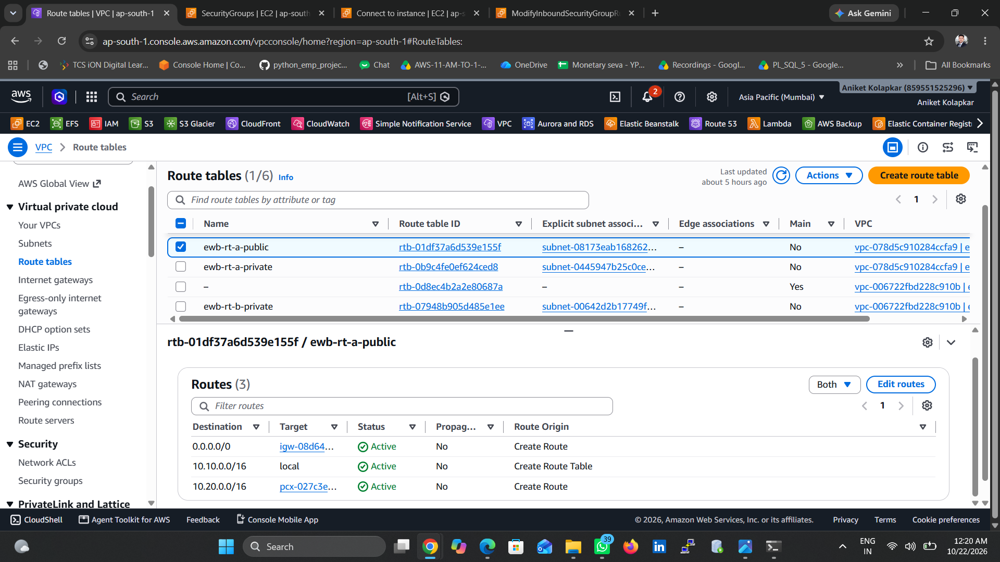

# AWS VPC Peering Project

**Name:** Aniket Rajendra Kolapkar  
**Batch:** AWS Internship Batch 1  
**AWS Region:** Asia Pacific (Mumbai) — `ap-south-1`

## Project Overview

This project demonstrates private network communication between two Amazon Virtual Private Clouds (VPCs) using AWS VPC Peering. It covers network planning, subnet configuration, route tables, security groups, EC2 access, connectivity testing, troubleshooting, and resource cleanup.

## Objectives

- Configure two VPCs with non-overlapping IPv4 CIDR ranges.
- Establish a VPC Peering connection.
- Configure forward and return routes.
- Restrict access through security-group rules.
- Validate private connectivity and troubleshoot a controlled connectivity failure.
- Document implementation and cleanup evidence.

## Network Design

| Resource | CIDR / Private IP |
|---|---|
| VPC-A | `10.10.0.0/16` |
| Public subnet A | `10.10.1.0/24` |
| Private subnet A | `10.10.2.0/24` |
| App-A | `10.10.2.10` |
| VPC-B | `10.20.0.0/16` |
| Private subnet B | `10.20.1.0/24` |
| App-B | `10.20.1.10` |

A bastion host in VPC-A was used for administrative SSH access. The application instances had no public IPv4 addresses.

## Implementation

1. Created the VPCs and subnets.
2. Configured the Internet Gateway and route-table associations.
3. Established the VPC Peering connection.
4. Added routes for the remote VPC CIDR in both directions.
5. Configured security groups for SSH administration and ICMP testing.
6. Tested connectivity between the application instances using private IP addresses.

## Testing and Results

- **App-A to App-B:** Four ping replies, with 0% packet loss.
- **App-B to App-A:** Four ping replies, with 0% packet loss.
- **Controlled negative test:** Removing the relevant inbound ICMP Echo Request rule caused 100% packet loss in the tested direction.
- **Recovery test:** Restoring the rule returned the test to four replies, with 0% packet loss.

These results demonstrate the tested private ICMP connectivity and the effect of security-group permissions.

## Security Considerations

- Application instances were accessed through a bastion host.
- SSH and ICMP permissions were scoped to specific source addresses.
- Private IP addresses were used for inter-VPC connectivity tests.
- AWS private keys and credentials must never be committed to this repository.

## Cleanup

Project resources were removed through the AWS Console after evidence collection, as recorded in the project report. The AWS Console and Billing dashboard should be checked to confirm that no billable project resources remain.

## Project Evidence

The accompanying project report and screenshots document the configuration, testing, troubleshooting, and cleanup workflow.

**Note:** The initial pre-peering baseline ping was not captured, so no result is claimed for that test.

## Project Screenshots

The following screenshots demonstrate the key stages of the AWS VPC Peering project, including network configuration, routing, security groups, and connectivity testing.

### 1. VPC-A Creation

### 2. VPC-B Creation

### 3. VPC Peering Connection

### 4. Security Group Rules

### 5. Route Table Configuration

